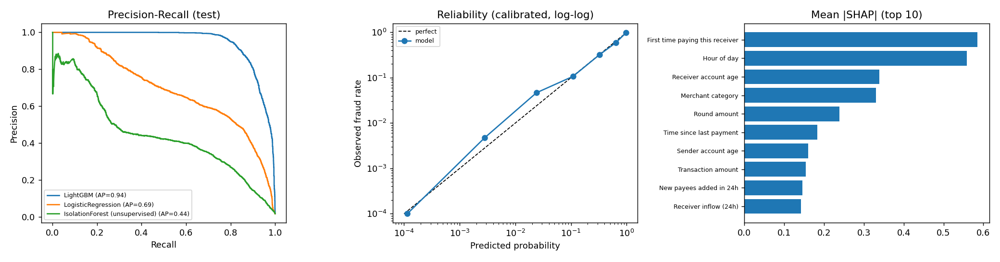
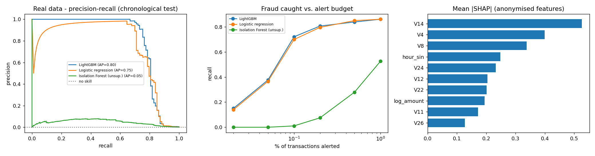
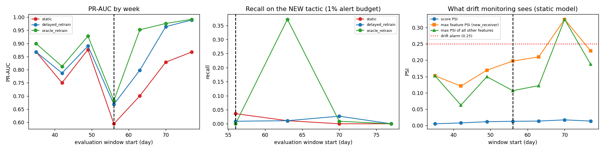

# UPI Behavioural Risk Intelligence

 
 

A fraud-intelligence platform for UPI-style payments: a **~740k-payment simulated world** (12 cities, 13 merchant categories, calendar effects, account lifecycles,
**8 fraud typologies**), leak-free behavioural features, calibrated gradient boosting, cost-optimal decisions, conformal uncertainty, graph analytics, a streaming feature
store proven identical to training, a drift / label-delay backtest, a **17-module analyst console**, and a statistical evidence pack that includes a **real public fraud dataset**.



## At a glance
| | |
|---|---|
| **World** | 741k payments, 12k customers, 700 merchants, 91 days; presets `small` (0.2M) / `medium` (0.75M, default) / `large` (3M+) |
| **Fraud typologies** | account takeover (SIM-swap) - velocity attack - collect scam - mule rings - structuring under limits - impossible travel - dormant-account reactivation - investment scam (+ an opt-in novel tactic for drift tests) |
| **Features** | 25, all computed from past data only: velocity, amount-vs-history, payee fan-in/out, geo-speed, new city/device, just-under-limit, account ages, merchant category ... |
| **Decisions** | calibrated risk -> cost-optimal APPROVE / STEP_UP_AUTH / REVIEW / BLOCK, plus conformal "uncertain" sets |
| **Serving** | FastAPI: live scoring ~5 ms median (SHAP included), what-if counterfactuals, audit log, case management |
| **Console** | 17 modules: executive KPIs, live stream, analyst queue, customer 360, geo map, merchant radar, rings, typologies, threshold lab, explainability, drift, evidence, ... |
| **Engineering** | 45 tests (incl. batch/stream parity), 11 CI quality gates, Docker, GitHub Actions |

## Results (simulated world, chronological hold-out; 95% CIs from a cluster bootstrap over 11,706 accounts, 2,743 test frauds)
| | PR-AUC | Recall at the rule set's alert volume (1.4%) |
|---|---|---|
| **LightGBM** | **0.945** [0.933, 0.957] | **0.768** [0.714, 0.813] |
| Logistic regression | 0.691 [0.648, 0.731] | 0.533 [0.495, 0.572] |
| Hand-written rules | - | 0.276 [0.236, 0.313] |

Paired gains: **+0.254** PR-AUC over logistic regression [0.216, 0.297]; **+0.492** recall over the rules [0.441, 0.546]. Five independently generated worlds (small preset): PR-AUC
**0.942 +/- 0.020**, recall 0.761 +/- 0.060 vs. rules 0.212 +/- 0.032. Time-series CV 0.941 +/- 0.015.

**Operating policy (test period):** flags 4.5% of payments, catching **98.8%** of fraud at 38% precision (APPROVE 149,949 with 32 frauds missed - STEP_UP 4,430 / 370 fraud -
REVIEW 329 / 151 - BLOCK 2,301 / 2,190). Recall by typology is ~100% for six of eight typologies and 96.6% for velocity attacks. Savings vs. approving everything stay within
**98.1-99.6%** across every cost-assumption scenario (but see the caveat below). Rings: **34 of 36** recovered, 100% node precision. Mule ranking precision@20: **0.95**.

**Conformal uncertainty:** targets 90% fraud / 98% genuine coverage; achieved 87.6% / 97.9% on the later test period (the shortfall is the price of distribution shift); 2.0% of payments are "uncertain"
(9% of them fraud), confident-fraud calls are 85.5% precise.

### Real data: ULB credit-card fraud (283,726 txns after de-duplication, 0.17% fraud, chronological split, 93 test frauds)


| | PR-AUC [95% CI] | recall at 0.1% alert budget |
|---|---|---|
| LightGBM | 0.803 [0.723, 0.883] | 72% |
| Logistic regression | 0.750 [0.647, 0.858] | 70% |
| Isolation Forest (unsupervised) | 0.048 | 1% |

Honest reading: on real data LightGBM's edge over logistic regression is small (paired +0.054, CI [0.001, 0.118]), and a **random split overstates the score by 0.07** (0.861 vs. 0.792) -
which is why every evaluation here is chronological. The large gaps above are properties of my simulator, not of fraud in general.

### Drift and label delay (12 simulated weeks, new tactic from week 8, labels arrive 7 days late)


| Policy | mean PR-AUC after drift | new-tactic recall (1% / 3% alert budget) |
|---|---|---|
| Static (never retrained) | 0.748 | 1% / 23% |
| Delayed retrain (production-realistic) | 0.855 | 1% / 58% |
| Oracle retrain (instant labels, unattainable) | 0.901 | 10% / 78% |

The first week of a new tactic hurts *every* policy; label delay costs about one extra window; retraining only helps if alert capacity exists to surface the new pattern; and monitoring was
late or blind: score PSI never exceeded 0.02 and feature PSI crossed the alarm line only two weeks after onset.

### Serving
Live scoring through the streaming feature store takes **~5 ms median / ~8 ms p99 with SHAP** (single core, in-process) at 741k history rows, versus **~72 ms / ~449 ms** for re-scanning history
(point-in-time mode). See `reports/latency.json`.

## Console tour (17 modules, `streamlit run dashboard/dashboard.py`)
| Area | Modules |
|---|---|
| **Command Center** | Executive Summary (KPIs, anomaly-flagged daily fraud rate, alert funnel) - Live Stream Monitor (replay payments in time order, loss with vs. without the model) - Analyst Case Queue (REVIEW cases ranked by expected loss, SHAP reasons, resolve cases, capacity planner) |
| **Investigation** | Customer 360 (timeline, counterparties, ego network) - Geo Intelligence (map, impossible-travel events) - Merchant Intelligence (category risk, scam-merchant radar) - Rings & Mules - Typology Explorer (fingerprint, SHAP drivers, missed examples) |
| **Model & Policy** | Model Performance - Threshold & Cost Lab (live cost-optimal thresholds, capacity mode, conformal sets) - Explainability (SHAP by typology, dependence plots) - Simulator & What-If (counterfactual scenarios) |
| **Monitoring & Evidence** | Drift & Monitoring - Evidence & Robustness (real data, bootstrap, backtest, fairness, tuning, conformal) - System Health (CI gates, latency, data volume) |
| **Data & Governance** | Data Explorer (filters, pivots, CSV export, data quality) - Audit & Cases (decision audit trail, analyst cases, fairness audit) |

## Analysis notebooks
* [`01_analysis_and_modelling.ipynb`](notebooks/01_analysis_and_modelling.ipynb) - EDA, rules vs. ML, imbalance strategies, feature-group ablation, calibration, SHAP, error analysis.
* [`02_evidence_and_robustness.ipynb`](notebooks/02_evidence_and_robustness.ipynb) - real data, bootstrap CIs, multi-seed, cost sensitivity, drift backtest, parity, fairness, tuning, conformal.

## Quick start
```bash
python -m venv venv && source venv/bin/activate      # Windows: venv\Scripts\activate  (then use `python -m pip`, `python -m streamlit`, ... if launchers are blocked)
pip install -r requirements-dev.txt
python -m src.pipeline --scale small                 # ~1 min: simulate, train, evaluate   (omit --scale for the 0.75M-payment medium world, ~5 min on a laptop)
python -m pytest -q                                  # 45 tests
python -m src.benchmark && python -m src.gates       # latency + 11 quality gates
streamlit run dashboard/dashboard.py                 # console:  http://localhost:8501
uvicorn backend.api:app --reload                     # API docs: http://127.0.0.1:8000/docs
make advanced                                        # real data, bootstrap, multi-seed, backtest, tuning (needs internet once)
```
Scales: `small` ~0.2M, `medium` ~0.75M (default), `large` ~3M+ payments (needs considerably more RAM and time; not benchmarked here). The console itself is light: the scored medium dataset takes ~240 MB in memory. `docker compose up --build` starts the API (:8000) and console (:8501);
set `UPI_API_KEY` to require an `X-API-Key` header.

## Deploy (Streamlit Community Cloud, free)
1. Push the repository to GitHub (generated data is git-ignored on purpose - the repo stays ~1 MB).
2. On share.streamlit.io choose **New app**, pick the repo, branch `main`, and set the main file to `dashboard/dashboard.py`. `requirements.txt` and `packages.txt` are picked up automatically.
3. The first visit simulates a small world and trains the model once (~1 minute, ~0.6 GB peak memory), then every visit reuses it. Set the secret/env var `UPI_BOOT_SCALE=medium` for the full world if the host has the memory.
The API (`backend/api.py`) deploys separately as a container: any Docker host can build the included `Dockerfile` (`docker compose up --build` locally). Set `UPI_API_KEY`; audit and case databases are SQLite files and need a persistent disk to survive restarts.

## API
| Endpoint | Purpose |
|---|---|
| `POST /score` | Risk, decision, SHAP reasons, warnings, audit id. `?commit=true` records the payment in live state; `?explain=false` for lowest latency |
| `POST /what-if` | Re-scores the payment under realistic alternatives (smaller amount, usual device, home city, no collect request, 2 pm) |
| `POST /score/batch` | Up to 100 payments |
| `GET /audit`, `/stats`, `/rings`, `/model-info`, `/health` | Audit trail, counts, graph results, metrics/thresholds, liveness |

Scoring modes: **live** (timestamp omitted or newest: O(1) store lookups) and **point-in-time** (earlier timestamp: features rebuilt strictly from the past, defaults such as the usual device
taken from the customer's state *at that time*).

## Project layout
```
src/        config, geo, generate_data (v2 world), dataset, validation, features, online (streaming store), train, calibration, conformal, costs, cases,
            rules, graph, fairness, monitoring, scoring, audit, robustness, backtest, tune, realdata, benchmark, gates, pipeline
backend/    FastAPI service        dashboard/  console entry point        ui/  shared loaders + 17 view modules
notebooks/  two executed notebooks tests/      45 tests          docs/  ARCHITECTURE.md, MODEL_CARD.md          reports/  metrics + figures
```

## Limitations (stated up front)
* The UPI system is trained on **simulated** data whose fraud patterns I wrote. I iterated the simulator to remove giveaways (e.g. scam merchants with zero genuine traffic, genuine accounts that are never new),
  yet six of eight typologies are still recalled at ~100%: the injected signatures are strong. The real-data benchmark (0.80 PR-AUC) is the better guide to real-world difficulty, and it validates *method*, not UPI performance.
* Real fraud prevalence is 10-100x lower, so false-alert costs would weigh far more and the savings percentage would be much smaller.
* Per-transaction scoring cannot see the first leg of an attack; history features such as `new_receiver` drift by construction (40% -> 18% across the twelve weeks after warm-up).
* Conformal coverage degrades under drift; latency is measured in-process on one core with no network or load test; the Docker setup was not run in the build environment.

## Roadmap
Bounded look-back windows for history features - outcome-based monitoring with a challenger model - shadow-mode deployment - receiver-side graph embeddings / GNN - Kafka + Redis feature store - analyst-feedback retraining loop.
