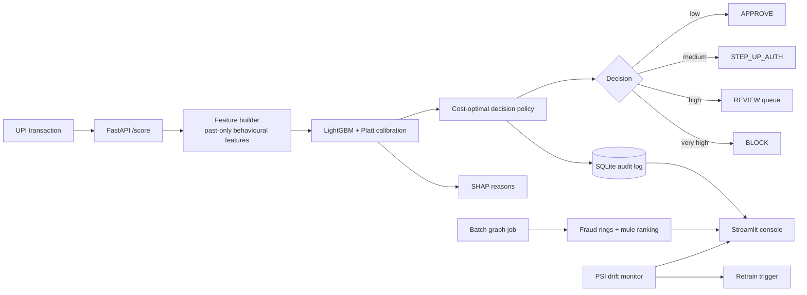

# Architecture

## Modules
| Module | Responsibility |
|---|---|
| `src/generate_data.py` | Synthetic UPI traffic with labelled fraud scenarios and hard legitimate look-alikes |
| `src/validation.py` | Schema / data-quality gate before training and scoring |
| `src/features.py` | Leak-free behavioural features (verified by a unit test) |
| `src/train.py` | Time-based split, models, calibration, thresholds, evaluation, artifacts |
| `src/calibration.py` | Platt scaling so scores behave like probabilities |
| `src/costs.py` | Expected-cost model and threshold optimiser |
| `src/graph.py` | Ring detection (SCCs in sliding windows) and mule-account ranking |
| `src/monitoring.py` | Population Stability Index drift report |
| `src/online.py` | Streaming feature store (O(1) state per account) proven identical to batch features by a parity test |
| `src/scoring.py` | `RiskEngine`: live mode (store lookups, ms) and point-in-time mode (no look-ahead replay); shared by API and dashboard |
| `src/robustness.py` | Cluster-bootstrap CIs, 5-seed stability, cost-assumption sensitivity |
| `src/backtest.py` | Label-delay + concept-drift backtest comparing static / delayed-retrain / oracle policies |
| `src/tune.py` | Optuna search with time-aware CV and a significance check on the gain |
| `src/realdata.py` | Real public benchmark (ULB credit-card fraud) validating the modelling methodology |
| `src/fairness.py` | Segment audit: who bears the false positives? |
| `src/gates.py` | CI quality gates: a regressed model fails the build |
| `src/benchmark.py` | Serving latency benchmark (p50/p95/p99) |
| `src/audit.py` | Append-only SQLite decision log |
| `backend/api.py` | FastAPI service: validation, optional API key, batch scoring, audit |
| `dashboard/dashboard.py` | Streamlit analyst console (9 modules) |

## Design decisions
* **Time-based split, never random** - random splits leak the future into training for behavioural data.
* **Warm-up period** - the first 14 days only build history and are excluded from training/evaluation. Without this,
  `new_receiver` shows PSI 0.35 (false drift) because every early payment looks like a first-time payee.
* **Cost-optimal thresholds, not accuracy** - a missed Rs 50,000 fraud and a wrongly blocked Rs 100 payment are not equal errors.
  Thresholds minimise expected INR cost on a validation slice held out from calibration.
* **Strictly ordered tiers** - the optimiser forces step-up < review < block so an analyst queue always exists.
* **Calibration on one validation half, thresholds on the other** - avoids tuning and calibrating on the same rows.
* **Explainability** - SHAP values from LightGBM are in log-odds of the raw model; they explain direction and magnitude of each factor.
* **Auditability** - every API decision is stored with score, decision, reasons and model version.

## Serving design: eliminating training/serving skew
Training uses vectorised `build_features` over the full history. Serving cannot re-scan history per request, so `OnlineFeatureStore`
keeps running sums (for the amount z-score and ratio), sorted recent timestamps (for 10-minute / 1-hour / 24-hour windows),
and seen-sets (new receiver / new device). `tests/test_online.py` replays an entire dataset through the store and asserts every
feature of every row equals the batch value - the standard guard against silent skew. Result: live scoring is ~5 ms median / ~7 ms p99 with SHAP, versus ~24 ms median / ~58 ms p99 for re-scanning history.

## Evidence pyramid
1. Unit tests (leakage, parity, cost maths, graph logic, API contract)  2. Hold-out + time-series CV  3. Cluster-bootstrap CIs
4. Five independently generated datasets  5. Cost-assumption sensitivity  6. Real public dataset  7. Label-delay / drift backtest
8. CI quality gates on every push.

## v2 additions
* **World simulator (`generate_data.py`)** - presets, real city coordinates, 13 merchant categories, calendar effects, account lifecycles, 8 typologies, opt-in drift scenario. Iterated twice to remove giveaways
  (zero-genuine scam merchants; non-stationary account ages caused by an ageing mule cohort).
* **Features** - geo-speed (haversine), new city, just-under-limit, payee fan-out (new payees in 24h) and fan-in (a receiver's new payers in 24h), account ages, merchant category; all mirrored in the streaming store.
* **Conformal sets (`conformal.py`)** and **fast cost optimiser (`costs.optimize_thresholds_fast`)** - histogram-binned and fully vectorised so the console's threshold lab recomputes live.
* **What-if engine (`RiskEngine.what_if`)** - exact counterfactual re-scoring through the real feature pipeline (descriptive, not causal).
* **Case management (`cases.py`)** - analyst resolutions stored as delayed labels (the feedback loop).
* **Store snapshot** - the streaming state is pickled once per history version so the engine restarts in seconds even at 700k+ rows.
* **Console (`ui/`)** - shared cached loaders + 17 view modules grouped into five areas; every page is smoke-tested headlessly in CI.
